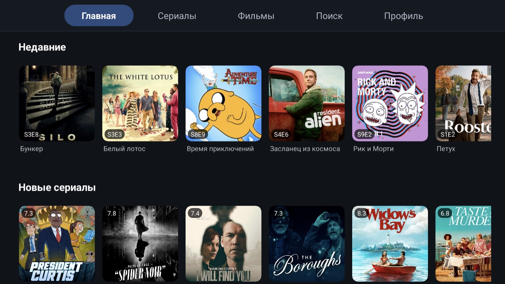
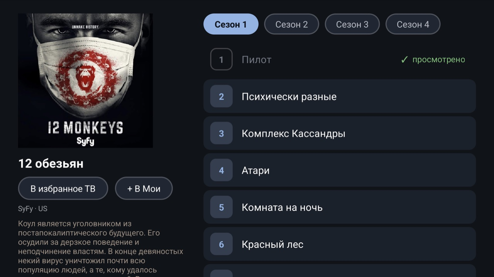

# Soap TV

Неофициальный нативный клиент [soap4](https://soap4youand.me) для Android TV. Нужна своя подписка soap4. Проект не связан с авторами soap4.





## Возможности

- Вход по логину и паролю soap4.
- Вкладки «Главная», «Сериалы», «Фильмы», «Поиск», «Профиль».
- Экран сериала с сезонами и сериями, экран фильма.
- «Мои» и отметки просмотра для фильмов, сериалов, сезонов и серий. Серия отмечается сама, когда до конца остаётся 10%.
- Фильтры фильмов: «Мои», 4K, просмотренные, жанр, год.
- Плеер на ExoPlayer:
  - перемотка ±10 с стрелками, пауза на OK или пробел;
  - озвучка стрелками вверх и вниз, выбор запоминается;
  - удержание OK открывает меню с переводом и качеством;
  - позиция серии сохраняется на сервере;
  - следующая серия запускается сама.
- Ссылки `soap4ad://open?sid=<id>` и `soap4ad://open?movie=<id>` открывают сериал или фильм, `?title=<название>&year=<год>` ищет по названию.

Пока нет:
- субтитров;
- сохранения позиции фильмов;
- франшиз и сортировок фильмов.

## Интеграция с TV Home

Soap TV работает в паре с лаунчером [TV Home](https://github.com/ad/tv):
- кнопка «В избранное ТВ» на экране сериала или фильма добавляет его на главный экран лаунчера;
- лаунчер открывает сериал или фильм в Soap TV ссылкой `soap4ad://open`.

Без TV Home всё остальное работает.

## Установка

APK лежит в [релизах](https://github.com/ad/soap4ad/releases/latest).

```bash
adb install -r soap-tv-v0.1.N.apk
```

## Сборка

Нужны JDK 17+, Android SDK с platform 36 и build-tools, `curl`, `unzip`, `shasum`. Gradle не нужен.

```bash
client/build.sh
client/check.sh
```

- `build.sh` скачивает зависимости из `client/deps.txt`, сверяет sha256 и собирает APK через aapt2, javac и R8.
- `check.sh` прогоняет JVM-проверки из `client/test/` поверх свежей сборки.
- Без ключа получается `client/soap-tv-unsigned.apk`.
- С ключом получается `client/soap-tv.apk`. Ключ задаётся переменными `KEYSTORE_FILE`, `KEYSTORE_PASSWORD`, `KEY_ALIAS`, `KEY_PASSWORD` или файлом `signing.env` в корне.
- Сборка сверяет подпись с `CERT_SHA256` в `client/build.sh`. Для своего ключа поменяйте это значение.

GitHub Actions на каждый push в `main` собирает подписанный APK, прогоняет проверки и публикует релиз `v0.1.<номер сборки>`. Ключ берётся из секретов `KEYSTORE_BASE64`, `KEYSTORE_PASSWORD`, `KEY_ALIAS`, `KEY_PASSWORD`.

Баннер ТВ рисует `art/banner.py`: `uv run --with pillow python art/banner.py client/res`.

## API

Что известно об API soap4: [API.md](API.md).

## Лицензия

[MIT](LICENSE).
